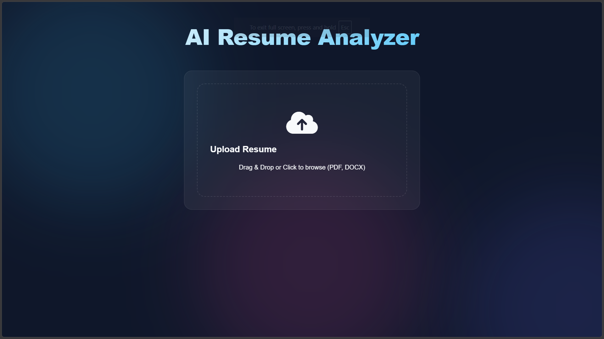
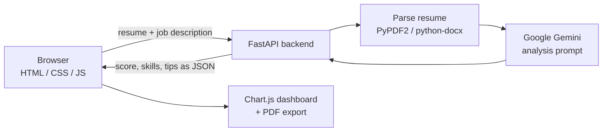

# 📄 AI Resume Analyzer

An AI-powered career assistant that helps job seekers get past Applicant Tracking Systems (ATS). Upload a resume, paste a job description, and get an ATS match score, a skill-gap analysis and specific tips for improving it, all powered by Google Gemini.

**🔗 Live demo:** https://ai-resume-analyzer-frontend-kappa.vercel.app




## 🚀 Features

- **🎯 ATS scoring:** a quantified match score against a specific job description.
- **🛠 Skill-gap analysis:** shows the strengths you already have and the skills the role needs that your resume is missing.
- **💡 Actionable insights:** targeted feedback on formatting, keyword optimization and clarity.
- **📊 Interactive visualizations:** a doughnut chart for the overall score and a radar chart for skill balance.
- **📄 Exportable reports:** download the analysis as a formatted PDF or a quick text summary.
- **🪟 Modern UI:** responsive glassmorphism design.

## 🏗️ How it works



1. The user uploads a resume (PDF or DOCX) and provides a job description.
2. The backend extracts the resume text.
3. Gemini compares the resume against the job description and returns a structured analysis.
4. The frontend renders the score, charts and recommendations, and can export a report.

## 🛠️ Tech stack

| Layer | Tools |
|---|---|
| Backend | Python, FastAPI, Google Generative AI (Gemini) |
| Frontend | Vanilla JavaScript, Chart.js, HTML5, CSS3 |
| Utilities | PyPDF2, python-docx, python-dotenv |
| Infra | Docker Compose, Vercel (frontend demo) |

## 🚀 Getting started

### Prerequisites

- Python 3.9+
- A [Google Gemini API key](https://aistudio.google.com/)

### 1. Clone and configure

```bash
git clone https://github.com/satwikgeddada/AI-Resume-analyzer.git
cd AI-Resume-analyzer
cp .env.example .env
```

Edit `.env` and add your key:

```env
GEMINI_API_KEY=your_api_key_here
```

> ⚠️ Never commit your `.env` file. Only `.env.example` belongs in the repo.

### 2. Run the backend

```bash
cd backend
python -m venv venv

# macOS / Linux
source venv/bin/activate
# Windows
.\venv\Scripts\activate

pip install -r requirements.txt
python main.py
```

### 3. Open the frontend

Open `frontend/index.html` in your browser, or serve it with a simple static server:

```bash
cd frontend
python -m http.server 5500
```

then visit http://localhost:5500.

### Optional: Docker

```bash
docker-compose up --build
```

## ⚙️ Configuration

The upload folder should be a path that works on your machine. Prefer a relative path so the project runs anywhere:

```python
# backend/main.py
from pathlib import Path

UPLOAD_DIR = Path(__file__).parent / "uploads"
UPLOAD_DIR.mkdir(exist_ok=True)
```

## 🔒 Privacy

Resumes contain personal information. Uploaded files are used only to generate the analysis, and the text is sent to the Gemini API for processing. If you deploy this publicly, add a privacy notice and delete uploaded files after analysis.

## 🗺️ Roadmap

- [ ] Delete uploaded files automatically after analysis
- [ ] Support more file formats and better handling of scanned PDFs
- [ ] Rewrite suggestions for individual resume bullet points
- [ ] Unit tests for file parsing and response validation
- [ ] GitHub Actions CI (lint + tests)

## 🤝 Contributing

Contributions are welcome. Fork the repo, create a feature branch (`git checkout -b feature/your-feature`), commit your changes and open a pull request.

## 📝 License

Distributed under the MIT License. See the [LICENSE](LICENSE) file.

## 👤 Author

**Satwik Geddada**

- 🌐 Portfolio: [satwik-geddada-portfolio.vercel.app](https://satwik-geddada-portfolio.vercel.app/)
- 💻 GitHub: [@satwikgeddada](https://github.com/satwikgeddada)
- 💼 LinkedIn: [satwik-geddada](https://www.linkedin.com/in/satwik-geddada-72bb172b9)
